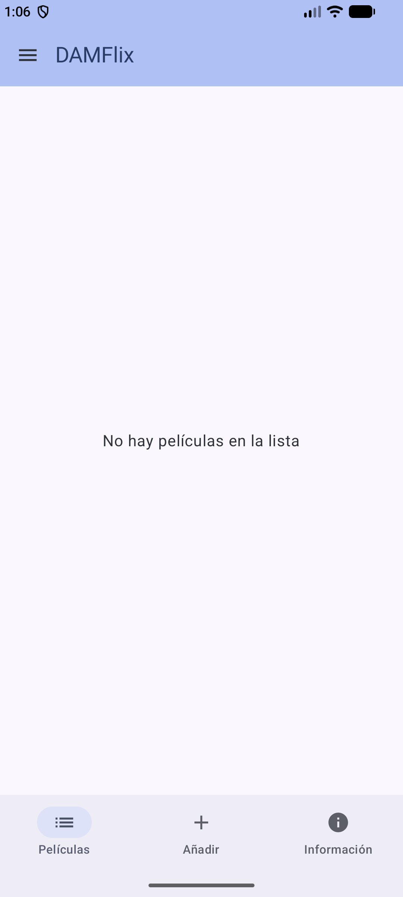

# DAMFlix 🎬

Aplicación nativa para Android que permite gestionar un catálogo personal de películas.
Desarrollada en **Kotlin** con **Jetpack Compose** (Material 3) y **Room** (SQLite),
siguiendo la arquitectura **MVVM**.

## Funcionalidades

- **Alta** de películas (título, director, año de estreno y estado «ya vista»).
- **Listado** reactivo del catálogo: cualquier cambio en la base de datos
  actualiza la interfaz automáticamente (Room `Flow` → `StateFlow`).
- **Edición** de cualquier película: el formulario se rellena con los datos
  guardados y se validan de nuevo antes de guardar.
- **Eliminación** de películas, con diálogo de confirmación previo.
- Marcar o desmarcar cada película como **favorita** ❤️.
- Navegación entre pantallas con **Navigation Compose** (menú lateral y barra inferior).

## Capturas de pantalla

Todas las capturas están tomadas en un emulador Android (API 37).

| Lista vacía | Formulario de alta | Formulario relleno |
| ----------- | ------------------ | ------------------ |
|  |  |  |

| Validación de datos | Lista con película | Edición con datos precargados |
| ------------------- | ------------------ | ----------------------------- |
|  |  |  |

| Confirmación de eliminación | Pantalla de información |
| ---------------------------- | ------------------------ |
|  |  |

## Stack técnico

| Área              | Tecnología                                   |
| ----------------- | -------------------------------------------- |
| Lenguaje          | Kotlin 2.2                                   |
| Interfaz          | Jetpack Compose (Material 3)                 |
| Base de datos     | Room (SQLite)                                |
| Concurrencia      | Kotlin Coroutines + Flow (`StateFlow`)       |
| Arquitectura      | MVVM (ViewModel + Repository + DAO)          |
| Navegación        | Navigation Compose                           |
| Generación de código | KSP                                        |
| SDK mínimo        | Android 7.0 (API 24)                         |

## Cómo compilar

### Con Android Studio

1. Abre el proyecto en Android Studio.
2. Sincroniza el proyecto Gradle (el proyecto usa `compileSdk` 37).
3. Ejecuta el módulo `app` en un dispositivo o emulador (API 24 o superior).

### Desde la línea de comandos

```bash
./gradlew assembleDebug
```

El APK se genera en `app/build/outputs/apk/debug/app-debug.apk`.

> **Nota:** `local.properties` no se publica en el repositorio (está en `.gitignore`).
> Si Android Studio no lo genera, créalo en la raíz del proyecto con la ruta a tu SDK:
>
> ```
> sdk.dir=/ruta/a/tu/sdk
> ```

## Estructura del proyecto

```
app/src/main/java/com/example/damflix_2/
├── MainActivity.kt               # Actividad única; crea la factory del ViewModel
├── DamFlixApplication.kt         # Application: BD y repositorio (lazy, singleton)
├── Data/
│   ├── PeliculaRepository.kt     # Repositorio: alta, edición, eliminación
│   └── local/
│       ├── PeliculaEntity.kt     # Entidad Room (tabla "peliculas")
│       ├── PeliculaDao.kt        # DAO: consultas Room (Flow, insert, update, delete)
│       └── AppDatabase.kt        # RoomDatabase (singleton)
├── ViewModel/
│   ├── PeliculasViewModel.kt     # Estado observable (StateFlow) y operaciones
│   └── PeliculasViewModelFactory.kt
├── Navigation/
│   ├── Ruta.kt                   # Rutas de las pantallas
│   └── Navegacion.kt             # NavHost, menú lateral y barra inferior
└── ui/
    ├── View/
    │   ├── ListaPeliculas.kt     # Catálogo + editar/eliminar + confirmación
    │   ├── FormularioPelicula.kt # Alta
    │   ├── FormularioEditarPelicula.kt # Edición
    │   └── PantallaInformacion.kt
    └── theme/                    # Tema Material 3 (claro/oscuro)
```

## Autor

**Handrup Johan Fernández Hernández** — 2º DAM, CIFP Villa de Agüimes.
📧 handrup@outlook.es
